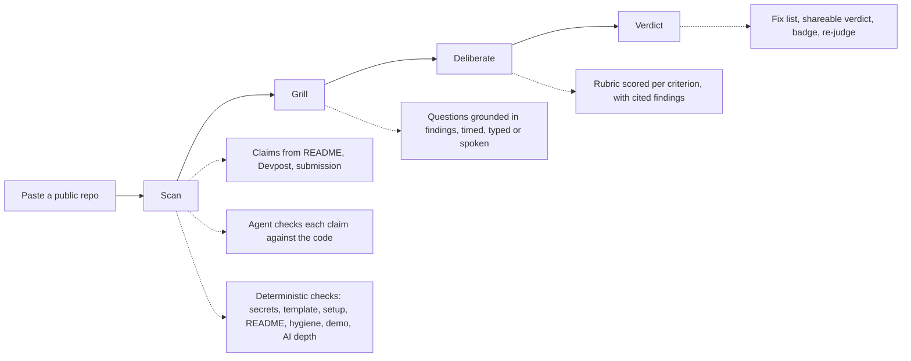

# Would This Win?

A pre-flight check for hackathon projects: three AI judges check your repo's claims against its code, grill you, and return a verdict as a code review.

<!-- GIF slot: docs/demo.gif (the README loop from the video project's out/ folder) -->

Live at [wouldthiswin.com](https://wouldthiswin.com).

## How it works



1. **Scan.** Claims come from the README, an optional Devpost page and pasted submission text. A tool-using agent checks each one against the repo at the exact commit and cites the lines. Deterministic checks look for leaked keys, starter-template leftovers, setup gaps, missing README essentials, hygiene issues, dead demo links and overstated AI.
2. **Grill.** Each judge asks one question grounded in a finding: the Engineer about the code, the Investor about users and money, the Tired Judge about what it even is. The clock starts after the question has rendered plus a 3-second read; answers can be typed or spoken. A vague answer gets one follow-up.
3. **Deliberate.** The panel talks it over and scores the rubric, citing findings.
4. **Verdict.** A code review: Ready to win or Changes requested, the scored rubric with evidence, a fix list sorted by severity and effort, and honest pitch tools. Opt in to a shareable verdict, a README badge and the public board.

## Trust model

- **Evidence before opinion.** Every finding cites a file and line range at the scanned commit, a commit, a URL or a deterministic check. No citation, no finding.
- **Code computes the score.** Models return bounded inputs (a verdict, a 0 to 10 rating, a criterion score) with a reason. Code validates, clamps, weights and turns them into odds. The model never outputs odds.
- **Fair to the team.** Integrity signals are framed as what a judge might ask, and sensitive findings (secrets, timeline, team split, transcripts) are only ever shown to the session's owner.

## Security model

- **Sessions** are owned by an httpOnly cookie and live on the server; the client only mirrors the server's view. Deadlines are computed from server timestamps.
- **Prompt injection.** Everything the team supplies, and everything fetched, is untrusted data inside escaped delimiters. Models never set scores, and an answer that reads like instructions is capped.
- **SSRF.** Every URL the team supplies is fetched GET only, with addresses checked at DNS time on every redirect, a timeout, a redirect limit, a size cap and, where it applies, a host allow-list.
- **RLS.** Row-level security is on for every table with no policies; only the server's service role reads or writes. Secrets stay server-side.

More in [docs/architecture.md](docs/architecture.md).

## Evals

`npm run eval` runs the deterministic checks on synthetic fixtures (an honest repo, an overclaiming README, a leaked key, a template leftover, and a README telling the judges to score 10):

| Check              | Precision | Recall |
| ------------------ | --------- | ------ |
| AI depth           | 100%      | 100%   |
| README essentials  | 100%      | 100%   |
| Secrets            | 100%      | 100%   |
| Setup              | 100%      | 100%   |
| Template leftovers | 100%      | 100%   |

The injection fixture changes no finding, and an injected answer scored by a model that obeys it still gets -6. `npm run eval -- --claims` also runs claim extraction and the verification agent (needs `ANTHROPIC_API_KEY`).

## Local setup

```bash
npm install
cp .env.example .env.local   # fill in the values below
npm run dev
```

Run the migrations in `db/migrations` against your own Supabase database, in order.

| Command                                                 | What it does                                                |
| ------------------------------------------------------- | ----------------------------------------------------------- |
| `npm run dev`                                           | Dev server                                                  |
| `npm run build`                                         | Production build                                            |
| `npm test`                                              | Unit tests (vitest)                                         |
| `npm run typecheck` / `npm run lint` / `npm run format` | TypeScript, ESLint, Prettier                                |
| `npm run eval`                                          | Check precision and recall on the fixtures                  |
| `npm run stats`                                         | Sessions, cost per session and step, cache hit rate, funnel |
| `npm run signals -- <repoUrl>`                          | Print a repo's computed signals                             |
| `npm run judges`                                        | Rebuild the judge sprites from `art/judges`                 |

## Environment variables

| Name                                        | Required | Purpose                                                                            |
| ------------------------------------------- | -------- | ---------------------------------------------------------------------------------- |
| `ANTHROPIC_API_KEY`                         | yes      | Claude: claim extraction, the verification agent, questions, scoring, deliberation |
| `GITHUB_TOKEN`                              | yes      | Reading public repos (a fine-grained, read-only token)                             |
| `SUPABASE_URL`, `SUPABASE_SERVICE_ROLE_KEY` | yes      | Storage, server-side only                                                          |
| `IP_HASH_SALT`                              | yes      | Salts the IP hashes behind the per-visitor limit                                   |
| `CRON_SECRET`                               | yes      | Authorizes the daily retention job                                                 |
| `GROQ_API_KEY`                              | no       | Voice answers (Whisper); without it, answers are typed                             |
| `MAX_SESSIONS_PER_USER_PER_DAY`             | no       | Default 5                                                                          |
| `MAX_SESSIONS_PER_DAY`                      | no       | Default 300                                                                        |
| `DAILY_SPEND_LIMIT_USD`                     | no       | Default 20, measured from logged spend                                             |
| `CLAIM_AGENT_MODEL`                         | no       | `haiku` (default) or `sonnet`                                                      |
| `NEXT_PUBLIC_SITE_URL`                      | no       | Canonical site for links, default `https://wouldthiswin.com`                       |

## License

[MIT](LICENSE)
